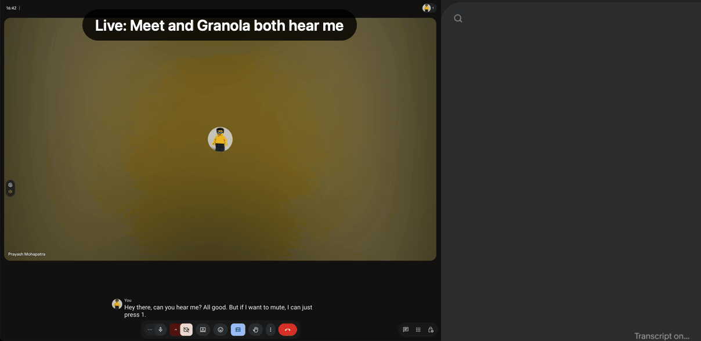
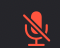
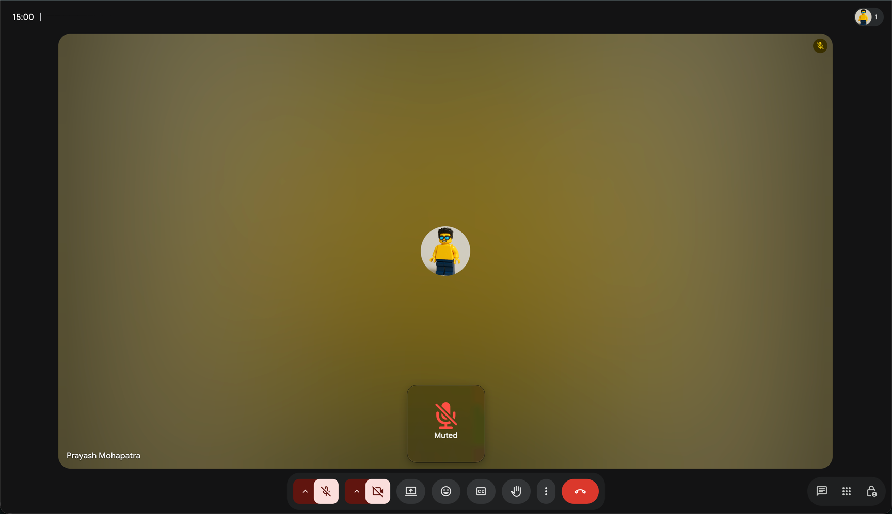

# mic-mute

A system-wide mute button for a USB mic on macOS. One press mutes Google Meet, Zoom and anything else using the mic (Granola included), works without focusing any window, and warns you if you talk while muted.

Built for a RØDE VideoMic GO II on a Logitech MX Master 3S button, but any USB mic and any way of opening an app works. Agent notes are in [AGENTS.md](AGENTS.md).



One press of the mouse Back button mutes Meet and Granola together. Talk while muted and a HUD reminds you; Granola's transcript stays empty until you unmute.

## Why it is built this way

Many USB mics have no mute control macOS can use, and setting their input volume to 0 often only turns them down, so a call app's auto gain brings your voice back. Muting inside one app (Cmd+D in Meet) doesn't stop other apps from hearing you. The reliable mute is to cut the audio before any app sees it:

```
USB mic ──sox bridge──▶ BlackHole 2ch (virtual mic) ──▶ Meet / Zoom / Granola
             ▲
  MicToggle stops/starts it
```

## What you get

| Piece                     | What it does                                                        |
| ------------------------- | ------------------------------------------------------------------- |
| MicToggle.app             | Toggle mute. Bind it to a mouse button, hotkey or launcher          |
| Menu bar mic icon         | Plain = live, red slash = muted , orange = bridge down (SwiftBar) |
| Chime                     | Three notes falling = muted, rising = live                          |
| "Muted" HUD               | Shown above Meet's controls (and on other screens) if you talk for ~1.5 s while muted in a call, with headphones on (on speakers the mic hears the other side) |
| Meet join-muted extension | New Meet tabs open with mic and camera off                          |



Muting also clicks Meet's own mic button so others see you as muted, and drops BlackHole's input volume to 0. If you joined Meet muted, the next press unmutes you everywhere.

## Requirements

- macOS 14 or later with the Xcode command line tools (`xcode-select --install`)
- [Homebrew](https://brew.sh): `brew install sox` and `brew install --cask blackhole-2ch` (BlackHole needs a reboot or `sudo killall coreaudiod`)
- Optional: [SwiftBar](https://github.com/swiftbar/SwiftBar) for the menu bar icon
- Google Chrome for the Meet integration

## Install

```sh
git clone <this repo> && cd mic-mute
MIC="RØDE VideoMic GO II" script/build
```

Run `script/build` without `MIC` to list your input devices. The name is saved to `~/.config/mic-mute/mic`, so later rebuilds don't need it. The build compiles the helpers into `~/.local/bin`, installs `~/Applications/MicToggle.app`, loads two launch agents (`local.mic-mute.bridge`, `local.mic-mute.watch`) and copies the SwiftBar plugin if SwiftBar is set up. macOS asks for microphone access the first time the bridge runs.

Then:

1. Point your call apps at the virtual mic: Meet: Settings > Audio > Microphone = BlackHole 2ch. Zoom: microphone = BlackHole 2ch (or Same as System if BlackHole is your default input).
2. Bind `~/Applications/MicToggle.app` to something you can press: a mouse button ("Open application" in Logi Options+ or OpenLogi), a Raycast hotkey, or a Shortcuts keyboard shortcut.
3. In Chrome: View > Developer > Allow JavaScript from Apple Events. This lets MicToggle click Meet's mic button. Any app you allow to control Chrome can then run JavaScript in your tabs. Approve the "control Google Chrome" prompts the first time.
4. Optional: load `src/meet-join-muted` in `chrome://extensions` (Developer mode > Load unpacked) to join Meet muted.
5. Optional, Zoom: Settings > Keyboard Shortcuts > Mute/Unmute > Enable Global Shortcut, if you also want Zoom's own mute icon in sync.

For recordings where quality matters, pick your real mic directly, not BlackHole.

## Privacy

The talking-while-muted watcher only opens the mic while you are muted and a call app is reading BlackHole. It uses Apple's built-in sound classifier, which returns a "speech" score only. Nothing is transcribed, stored or sent anywhere. The macOS orange mic dot shows whenever it is listening.

## Tuning

- Speech sensitivity: `MIN_CONF` and `IN_A_ROW` at the top of `src/micwatch`.
- HUD position: `aboveBottom` in `src/mutedtoast.swift`.
- Chimes: replace `src/chimes/{muted,live}.wav`.

Run `script/build` after any change.

## Remove everything

```sh
for l in bridge watch; do launchctl bootout gui/$(id -u)/local.mic-mute.$l; rm ~/Library/LaunchAgents/local.mic-mute.$l.plist; done
rm -r ~/Applications/MicToggle.app ~/.local/share/mictoggle ~/.config/mic-mute
rm ~/.local/bin/{bhvol,micvad,mutedtoast,micwatch}
rm "$(defaults read com.ameba.SwiftBar PluginDirectory)/mic.10s.sh"
brew uninstall --cask blackhole-2ch
```

Then point Meet and Zoom back at your real mic, unbind MicToggle, remove the Chrome extension, and turn off Chrome's "Allow JavaScript from Apple Events".

## License

[MIT](LICENSE)
